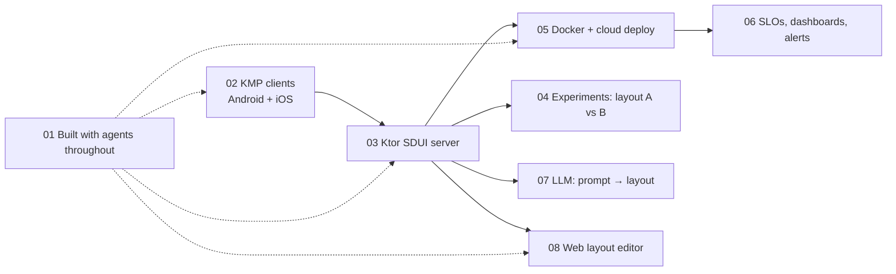

# The Method

This file is the *how*. [`roadmap.md`](roadmap.md) is the *what, right now*.
If the plan fails, come back here, adjust the method, and re-plan.

## Vocabulary

- **Lane** — an area worth learning (iOS, backend, SRE…). Lanes never "finish".
- **Milestone** — one rung on a lane's ladder. Small (roughly 3–15 hours),
  concrete, and ends in an **artifact**: something that exists afterwards — a
  merged PR, a deployed service, an app build, an article, a design file, a
  talk. "Read chapter 3" is not a milestone; "built X using chapter 3" is.
- **Card** — a single sitting's worth of work (30–90 min) toward a milestone.
  Cards live on the Now board in `roadmap.md`.
- **Season** — a ~12-week block. Each season has one **primary** lane, one
  **secondary** lane, and the always-on lanes. Seasons end with a re-plan.
- **Spine project** — one long-running personal project that every lane plugs
  into, so learning compounds instead of scattering (see below).

## Rules of the game

1. **WIP limit.** At most: 1 primary lane + 1 secondary lane + the always-on
   lanes (Agentic engineering, Foundations). Everything else is *parked*, not
   abandoned. Parked lanes are visible in `roadmap.md` so they don't nag.
2. **Every milestone ships an artifact.** If there's nothing to show, it
   wasn't finished — it was consumed.
3. **Learn in public, lightly.** Roughly one article a month on this site
   (`src/content/articles/`). Writing is how you find out what you actually
   understood, and it's the evidence that keeps you employable.
4. **Build on what you know.** Prefer milestones that connect to your real
   strengths — server-driven UI, payments, testing infra, Mockcat, your own
   Play Store apps. Adjacency makes progress fast, and fast progress is fun.
5. **Day job first, especially now.** You joined eBay in Sep 2026. Onboarding
   on TCGPlayer *is* learning. When work overlaps a lane (it often will),
   count it.
6. **Small > heroic.** 45 minutes on four days beats one 6-hour Saturday that
   burns you out. A missed day is fine; a missed week gets one line in the log
   explaining why, without guilt.
7. **Fun is a real criterion.** If a lane has stopped being fun for 3+ weeks,
   that's a signal for the monthly retro, not a character flaw.
8. **The plan is disposable.** Changing the plan is a successful outcome of
   planning. Record *why* in the log, so future-you learns from it.

## How lanes are prioritised

Each lane gets a 1–5 score on five criteria. The total decides the order, and
**dependencies** break ties (e.g. SRE needs something running to observe).

| Criterion | Question it asks |
| --- | --- |
| **Leverage** | Does this make me faster/better at *other* lanes and at my job? |
| **Adjacency** | How close is it to what I already know? (Closer = faster wins.) |
| **Market** | How strongly do job postings / industry direction reward it over the next 2–3 years? |
| **Job overlap** | Can I use it at eBay/TCGPlayer in the next few months? |
| **Fun** | Do I actually want to do this? (Only you can score this one.) |

### Current scores (v1, Oct 2026)

Fun is left blank on purpose — fill it in, then re-sort.

| Lane | Leverage | Adjacency | Market | Job overlap | Fun | Total (excl. fun) | Depends on |
| --- | :-: | :-: | :-: | :-: | :-: | :-: | --- |
| 01 Agentic engineering | 5 | 5 | 5 | 5 | ? | **20** | — |
| 02 Multiplatform & iOS | 4 | 5 | 4 | 4 | ? | **17** | — |
| 03 Backend | 4 | 4 | 5 | 3 | ? | **16** | — |
| 07 AI/ML app engineering | 5 | 3 | 5 | 3 | ? | **16** | 03 (for server-side AI) |
| 04 Product tools | 3 | 4 | 3 | 4 | ? | **14** | — |
| 08 Full-stack web | 3 | 3 | 4 | 2 | ? | **12** | 03 helps |
| 05 Cloud & DevOps | 3 | 2 | 4 | 2 | ? | **11** | 03 (something to deploy) |
| 06 SRE | 3 | 2 | 3 | 2 | ? | **10** | 03 + 05 |
| 09 Foundations | — | — | — | — | — | always on | — |

Why the order looks like this:

- **Agentic engineering is first and always on.** It's the change that's
  reshaping the job itself, you were already an early advocate at BookMyShow,
  and it speeds up every other lane. It's practised *through* the other lanes,
  not instead of them.
- **Multiplatform/iOS is the cheapest big step.** Mockcat already touches KMP
  and URLSession. Going from "Android developer" to "mobile engineer" is a
  real step up in employability for a small cost.
- **Backend before Cloud/SRE**, because you can't deploy or observe what
  doesn't exist. Kotlin on the server (Ktor) means zero language overhead.
- **Product tools are cheap and high-signal**, so they make a perfect
  *secondary* lane — a few hours here go a long way in product conversations.
- **AI/ML scores high but lands after backend**: the most employable version
  of it (LLM features, RAG, evals) needs a server. On-device AI is the
  exception and can be pulled earlier.

Re-score every season. Scores change because *you* change.

## The spine project

Learning many lanes in parallel scatters unless there's one thing they all
build on. Proposed spine:

> **SDUI Lab** — an open-source server-driven UI playground. A Kotlin backend
> serves screen layouts as JSON; Android and iOS clients (KMP) render them; a
> small web editor lets you change layouts live; it's deployed to the cloud,
> observed, A/B tested, and gets AI features (e.g. "describe a screen →
> generate the layout").

Why this one: SDUI is your strongest professional story, so every lane deepens
an expertise you already have instead of starting from zero. Each lane adds a
layer:

Alongside the spine, your **own Play Store apps** (Quiet, Morse Lab, Hanuman
Chalisa) are the place for anything that needs *real users*: analytics,
experiments, crash/reliability metrics, store releases.

The spine is a suggestion, not a contract. If another project excites you
more, swap it in at a season re-plan.

## Rhythm

| Cadence | Time | What happens | Where it's recorded |
| --- | --- | --- | --- |
| **Daily** | 30–90 min | Pick one card from Now. Do it. One line in the weekly log. | `log/YYYY-Www.md` |
| **Weekly** (Sun) | 15 min | What got done? What blocked? Refill Now with 3–5 cards. | same weekly file, "Review" section |
| **Monthly** | 30 min | Retro: energy, fun, is the season still right? Publish/plan the month's article. | `log/YYYY-MM-retro.md` |
| **Seasonal** (~12 wks) | 60–90 min | Re-score lanes, pick next primary/secondary, update spine, rewrite `roadmap.md`. Bump the plan version. | `log/season-N-review.md` |

Templates for each are in [`templates/`](templates/).

## When the plan breaks

It will. Common failure modes and the move for each:

- **Haven't touched it in 2+ weeks** → don't catch up. Pick the *smallest*
  card possible and do just that. Then a weekly review.
- **Milestone dragging for 3+ weeks** → it's too big. Split it, or drop it and
  log why.
- **Bored of the lane** → swap primary and secondary for a month, or park it.
- **Work is consuming everything** → shrink to the always-on lanes only, and
  look for where work already counts toward a lane.
- **Shiny new thing appears** → add it to "Inbox" in `roadmap.md`. It gets
  considered at the next monthly retro, not today.
